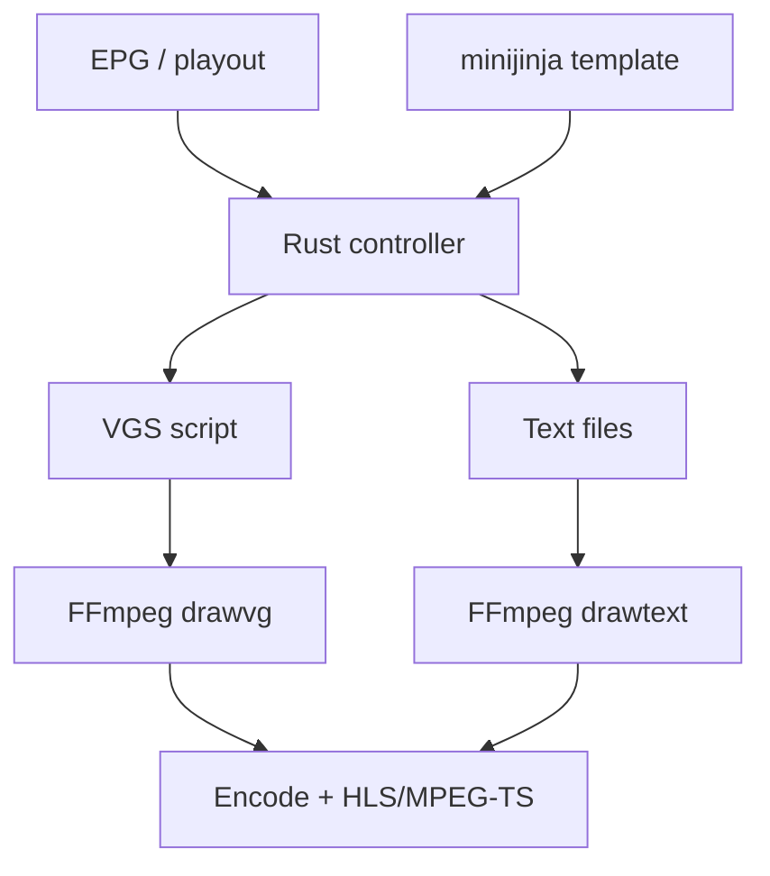

# ADR 0076: minijinja for music-video-credits subtitle templates

## Status

Accepted (2026-08-21)

## Implementation

Implemented (2026-08-21) — `render_music_video_credits_template` gains an
opt-in `minijinja` path, and the bundled `_MusicFactory_ArtistTitle` preset
uses it. The full two-pass workspace test closeout, both Clippy configurations,
the Leptos build, and the runtime smoke gate pass on Windows; the render path
was also validated against the real `minijinja` crate and libass out of tree.

## Context

Music-video-credits burn an ephemeral `.ass` subtitle over music videos
(`ersatzrs-infra::music_video_credits`). ErsatzTV authors these as Scriban
(`.sbntxt`) templates and evaluates them with the real Scriban .NET library, so
its bundled presets freely compute layout from the output resolution
(`resolution.height // 20`, `resolution.width * 0.03 | math.round`), loop,
`capture`, and call filters like `string.upcase`.

ErsatzRS never ported a Scriban engine for this path. `render_simple_template`
does fixed string substitution of an exact, closed set of expressions, and the
"advanced" presets (`_ArtistTitle_LeftMiddle`, `_ArtistTitleAlbum_CenterTop`)
are in fact re-implemented in Rust (`render_interval_template`) — the `.sbntxt`
body is only a trigger. That is fine for a handful of fixed presets but cannot
evaluate a *new* template that needs arbitrary maths.

The trigger was a new "Music Factory" (TMF) styled artist/title card. Its
layout is genuinely computed: a fixed-width gold bar (73% of the frame),
flush-stacked bars, and positions derived as `frame − margin − bar_height`.
The maintainer's explicit requirement was that this layout live **in the
template**, not in a per-preset Rust function nor in a scratch generator. There
is still no Scriban crate for Rust, but [ADR 0058](0058-minijinja-xmltv-channel-guide-templates.md)
already adopted `minijinja` (Jinja2-compatible, already a dependency) for the
XMLTV channel-guide templates.

## Decision

Add an opt-in `minijinja` rendering path to `render_music_video_credits_template`,
selected when the template contains the marker `ersatzrs:minijinja` (carried in
a leading `{# … #}` comment that the engine strips). Such templates are rendered
by `minijinja` with a flat context — `resolution.{width,height}`, `artist`,
`all_artists`, `title`, `album`, `track`, `plot`, `release_date`, `studios`,
`directors`, `duration_seconds`, `stream_seek_seconds` — so all sizing,
margins, positioning, joining and upper-casing live in the template. On any
render error the built-in default song-title card is substituted so playback
still receives a subtitle. The bundled `_MusicFactory_ArtistTitle` preset is
authored this way.

The legacy `render_simple_template` and `render_interval_template` paths are
left in place for the existing presets; they are not migrated. New computed
presets should use the `minijinja` marker.

This mirrors ADR 0058: port ErsatzTV's *pattern* (bundled defaults, on-disk
override of the same name, a flat context named after the domain) onto
`minijinja`, not Scriban's *syntax*.

## Rendering pipeline and direction

The wider point of this decision is architectural, not just one preset:
`minijinja` becomes the single template-authoring layer across ErsatzRS's
overlay stack. EPG/playout state and a `minijinja` template both feed one Rust
controller; the controller renders the template and turns it into the concrete
artifact each FFmpeg overlay backend consumes — a VGS script for `drawvg`
(ADR 0005), plain text for `drawtext`, or an `.ass` script for libass (this
preset). Every branch converges on the same encode + HLS/MPEG-TS mux.

In ErsatzRS today the text leg is served by drawvg as well — text elements
render as VGS via `text_drawvg` (ADR 0005) — so FFmpeg's own `drawtext` filter
is the *conceptual* text path in the diagram, not yet a code path; adding it is
tracked in [ADR 0077](0077-ffmpeg-drawtext-overlay-leg.md).

The takeaway (the point of the diagram): the music-video-credits `.ass` card is
not a special case with a bespoke engine. It is another consumer of the
same `template → controller → FFmpeg → mux` shape — its FFmpeg leg is the
`subtitles`/libass filter rather than `drawvg` or `drawtext`. This ADR therefore
sets a direction as much as it adds a preset: keep authoring in `minijinja`
templates and artifact production in the Rust controller, and retire the bespoke
per-preset Rust renderers (for example `render_interval_template`) instead of
adding more of them.

## Consequences

- Layout logic for computed presets lives in the editable template and is
  resolution-adaptive, with no per-preset Rust or out-of-band generator.
- One template engine (`minijinja`) now serves both XMLTV and music-video
  credits, matching serde-based context construction idiomatic to Rust.
- Templates use Jinja2 syntax, not literal Scriban: an ErsatzTV `.sbntxt` for
  this feature will **not** run verbatim (`| math.round` → `| round`,
  `array.join` → `| join(...)`, `string.upcase` → `| upper`) and must be ported
  and marked. This is the same fidelity trade-off ADR 0058 accepted.
- Two engines coexist in `templates/music-video-credits/`; the explicit marker
  disambiguates, and unmarked templates keep their legacy behavior.
- The error fallback means a broken user template degrades to the default card
  rather than dropping the subtitle or breaking the stream.

## Alternatives Considered

- Extend `render_simple_template` with the extra computed tokens the TMF card
  needs: rejected — the layout maths would still live in Rust, only referenced
  by the template, and the token list becomes a bespoke, per-preset menagerie.
- A dedicated Rust renderer per preset (as `render_interval_template` does):
  built first, then rejected by the maintainer — the layout must live in the
  template, not a Rust `format!`.
- Port a real Scriban-compatible evaluator so ErsatzTV templates run verbatim:
  rejected for now — largest effort, no maintained Rust crate, and `minijinja`
  is already present and sufficient.

## References

- [ADR 0058](0058-minijinja-xmltv-channel-guide-templates.md) — minijinja for
  XMLTV channel-guide templates (the precedent).
- [ADR 0005](0005-drawvg-graphics-engine.md) — drawvg for in-stream graphics;
  the VGS-script → `drawvg` leg of the pipeline above, and the engine that
  renders text overlays too (see below).
- `crates/ersatzrs-ffmpeg/src/graphics/mod.rs` — the Rust controller's `drawvg`
  (VGS) overlay leg, including `text_drawvg`, which renders text elements as
  VGS through drawvg rather than FFmpeg's `drawtext` filter.
- `crates/ersatzrs-ffmpeg/src/filter/simple.rs` — `subtitles_filter`, the
  libass leg that burns this preset's `.ass` card.
- `crates/ersatzrs-infra/src/music_video_credits.rs` — `render_minijinja_template`
  and the marker dispatch.
- `assets/templates/_MusicFactory_ArtistTitle.sbntxt` — first minijinja preset.
- `minijinja` (Jinja2-compatible template engine), already a dependency.
