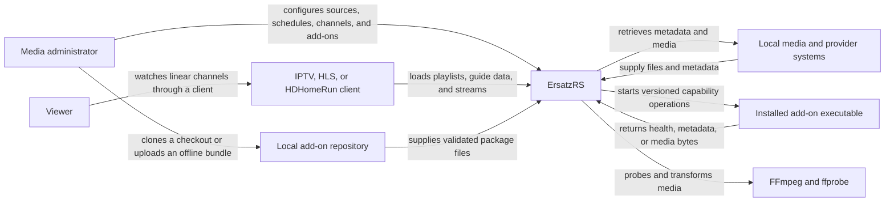
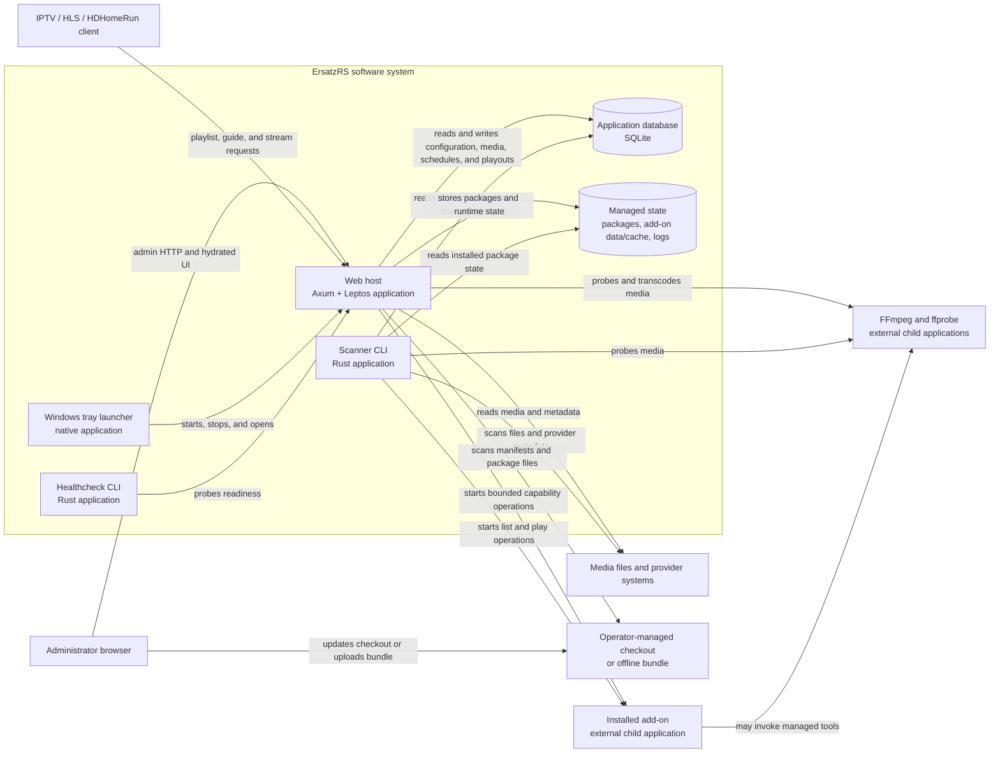

# Runtime architecture

This page explains the current running shape of ErsatzRS. It deliberately does
not mirror the Cargo workspace: crates and modules are code boundaries, while
C4 containers are applications and data stores.

## System context — ErsatzRS

ErsatzRS owns channel construction, scheduling, guide projection, streaming,
administration, and the persisted application model. Media providers, user
libraries, client applications, and operator-managed add-on repositories remain
outside that ownership boundary. The product-facing routes and supported source
types are listed in the [HTTP](../reference/http-endpoints.md) and
[media-source](../reference/media-source-support.md) references.

## Container view — ErsatzRS

The web host embeds the long-running scheduler, scan workers, local repository
discovery, and streaming lifecycles; those are not separately deployed containers. The
scanner executable is a separate one-shot application. The Windows launcher is
a real application only on Windows, and the healthcheck binary is a small
readiness client.

Installed add-ons and media tools cross an external child-process boundary;
they are not ErsatzRS crates or dynamically loaded libraries.
The database owns local-source, installation, setting, media, schedule, and
playout state; the managed state directories own immutable packages and
per-add-on data. [ADR 0051](../adr/0051-application-boundary-and-composition-root.md)
owns the application/composition-root decision, and
[ADR 0066](../adr/0066-repository-backed-add-ons.md) owns the add-on process
boundary, as amended by [ADR 0081](../adr/0081-use-local-addon-repositories.md)
for local acquisition. [ADR 0080](../adr/0080-standardize-on-sqlite.md) owns the SQLite-only
database boundary; the database file stays on one host and is not shared by
active-active servers.

## Evidence and excluded future state

The current view is grounded in the executable entry points, web composition
root, scanner integration, SQL migrations, and process-spawn paths in this
source tree. The repository node is operator-managed input, not a network
service or an ErsatzRS-owned Git process.

Teletext runtime components and the Phase 10 video-jukebox request API are not
shown because they do not yet have implementation evidence. They must not be
added to this current-state diagram merely because a plan or accepted decision
describes them.
