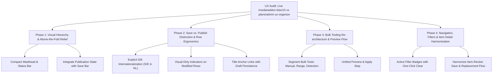

# Plan: Add-on List Workspace UX/UI Refinements

## Status

Proposed (2026-09-18). **Phases 1 and 2 implemented on 2026-09-18** at the
maintainer's request; phases 3–4 remain proposed.

Phase 1 delivered:

- Items shows only the publication state, counts, Publish action and a compact
  "Publication readiness" disclosure inside the heading. Finished preparation
  counters and a successfully completed publication job moved out of Items;
  Activity & recovery still shows both. Unfinished or failed preparation, and a
  queued, running, failed, expired or restored-after-failure publication job,
  still appear on Items.
- The floating draft status paragraph is no longer visible. After manual
  testing the maintainer rejected both a pill and a status text beside the
  title: the task's Save button is the indicator instead (outlined while the
  page matches the saved list, primary once anything on the page, including
  item rows, differs; server-rendered for retained drafts, updated live by
  `workspace-draft-status.js`). The `data-workspace-save-status` element remains
  as screen-reader-only text with the "Saved." / "Unsaved changes" contract;
  Activity has nothing to save and shows none. The full-width "Saved." banner
  after a save is no longer shown; other notices keep their banner.
- While preparation still has work, Items appends its progress to the counts
  line (for example "Completed 0/156 · Not queued 156"); the 13 counters stay on
  Activity & recovery.
- The publication summary keeps its own fieldset with the Items load-status
  `disabled` condition, so Publish is disabled exactly as before.

Evidence: on a copy of the Windows dogfood database (list 10, 166 items) at
1440×900 the first item row moved from y=810 (0 rows visible) to y=563 with
4 rows fully visible; no horizontal overflow at 320 and 768 pixels; no
console or hydration errors; no-JavaScript rendering unchanged in function.
`tests/e2e/addon-list-workspace.spec.ts` passes 44/44 (Chromium and Firefox,
no JS and hydrated). Deliberately not in phase 1: the disclosure still expands
in place (native `
`), and no layout was changed for tasks other than
the Save button state.

Originates from a comparative UX/UI audit between the live production workspace at `/media/addon-lists/:id` (e.g. `http://127.0.0.1:8409/media/addon-lists/10` implemented in [`crates/ersatzrs-web/src/admin/pages/media/addon_lists/workspace/`](../crates/ersatzrs-web/src/admin/pages/media/addon_lists/workspace/)) and the accepted reference design artifact in [`plans/admin-ux-organize`](admin-ux-organize/LOCK.md).

Phase 2 delivered (maintainer decisions of 2026-09-18 included):

- 2.1 Save vs Publish is superseded by ADR 0094: every saved change is
  published automatically and the only remaining Publish-intent button is the
  retry after a failure. Nothing was built; the Save button shows whether
  edits are saved.
- 2.2 Row numbering shows fixed `S` / `E` symbols in every language; the
  inputs keep localized accessible names (for example "Seizoen" / "Aflevering").
- 2.3 A row whose numbering or inclusion differs from the saved list gets
  `.row-dirty` (amber edge) and a visible "Unsaved changes" note, so the state
  is not conveyed by color alone. The server renders it for retained drafts
  (also without JavaScript); `workspace-draft-status.js` updates it live and
  clears it when the value returns to the saved one.
- 2.4 Adapted by maintainer decision: the title stays the draft-retaining
  submit button required by ADR 0091, and a separate "open in a new tab" icon
  link (`target="_blank"`, localized label, 44×44 px at 320 px) supports
  middle-click and right-click without discarding edits on the list.

Evidence: verified on the database copy in Dutch and English (hydrated and
no JavaScript, middle-click opens the item while the list stays); the new
`marks edited rows and opens items in a new tab without losing the draft` case
and the full `tests/e2e/addon-list-workspace.spec.ts` pass 48/48 in Chromium
and Firefox.

Follow-up requested during manual testing (2026-09-18): the list title in the
Items heading is edited in place. It is an Items-task field with a baseline;
Save changes stores it through the same list metadata command and
concurrency fence as List settings, and the fence is refreshed across List
settings, list artwork and Items after each save. Evidence: new e2e case
`renames the list from the Items heading` (no JS and hydrated), full spec
52/52, and 4 rows remain visible at 1440×900.

## Context and Purpose

The add-on list editor is one of the most feature-dense admin views in ErsatzRS. It orchestrates metadata editing, item review, inline numbering, provider playback options, artwork selection, durable background operations, atomic publication, and failure recovery.

The prototype in [`plans/admin-ux-organize/`](admin-ux-organize/index.html) established a locked task layout under [ADR 0091](../docs/adr/0091-lock-addon-list-task-design.md) (revision 1) to eliminate clutter, ensure draft retention without client JavaScript, and reduce cognitive load. The initial production adaptation in `amm-n-01b` successfully brought this architecture into Leptos SSR and islands. However, real-world usage of live lists (such as `/media/addon-lists/10`) reveals remaining ergonomic friction, visual hierarchy issues, above-the-fold content displacement, and bulk numbering density that fall short of the original design's intent.

This plan details the prioritized findings and defines a clear implementation blueprint to bring the live workspace into alignment with the locked design standards while resolving newly identified real-world friction.

---

## Audit Findings & Deficiencies

### 1. Above-the-Fold Content Displacement
* **Observation:** In a standard 900px viewport, almost no media items are visible upon entering `/media/addon-lists/:id`.
* **Root Cause:** A heavy vertical stack precedes the media list:
  1. Breadcrumbs and navigation tabs (`Items & review`, `List settings`, `Playback & access`, `Activity & recovery`).
  2. Full masthead with large H1 and presentation cover art.
  3. Stacking notice banners: arrival errors, workspace error summaries, and notices.
  4. Floating unstyled draft status paragraph (`data-workspace-save-status`).
  5. Publication summary card (`PublicationOverviewIsland`) plus the expandable publication details disclosure.
  6. Filter row.
  7. Bulk tools disclosure (`.bulk-tools`).
  8. Sticky save-bar.
  9. Column header row.
* **Impact:** Operators must immediately scroll to inspect media items. Reviewing items or doing quick manual numbering is obstructed by interface furniture.

### 2. Conceptual Ambiguity: Saving Drafts vs. Publishing Changes
* **Observation:** The primary action button near the top of the page is **"Publish saved changes"** (`PublicationOverviewIsland`), while row edits (season/episode, inclusion) rely on the sticky **"Save changes"** (`.numbering-save-bar`) further down.
* **Root Cause:** In the underlying model, "Publish" operates strictly on the *persisted draft revision* in the database. When an operator types new episode numbers inline and immediately clicks "Publish saved changes", the form POST carries the unsaved draft, but publication either proceeds on the prior saved state or generates an unsaved conflict.
* **Impact:** Operators experience confusion over whether their inline changes are live. The unstyled `data-workspace-save-status` text ("Niet-opgeslagen wijzigingen" / "Unsaved changes") lacks visual anchoring to the save action.

### 3. Bulk Numbering Tool Clutter & Preview Disconnect
* **Observation:** Inside `
`, all episode numbering controls are clumped into a single unorganized `<section>`.
* **Root Cause:** Three distinct mental tasks are rendered together without visual separation or subheadings:
  - Manual bulk numbering (Season, First episode, Count).
  - Scope and range selection (Start item, End item, Select range).
  - Auto-detection algorithms (Gap days, Season per year, Auto-detect button).
  - Runtime length filtering (Min/max duration disclosure).
  - Destructive clearing (Make unnumbered).
* **Preview Flow:** Triggering "Preview numbering" renders an inline comparison table (`bulk::preview`) outside the details disclosure, between the bulk panel and the save bar. It lacks an integrated "Apply" button directly inside the preview; operators must deduce that they must click "Save changes" on the detached save-bar.

### 4. Row-Level Ergonomics and Localization
* **Observation (NL Localization):** In Dutch, single-character headers and labels for Season and Episode (`tr(key).chars().next()`) render as **S** (Seizoen) and **A** (Aflevering).
* **Impact:** Video and media managers universally expect **S / E** or the abbreviations **Seiz. / Afl.** An "A" label for episode is confusing.
* **Missing Dirty State:** When an operator edits a season or episode number inline, the small helper text below remains static ("Saved: S01E02"). There is no visual highlight or indicator on the row showing that it contains pending unsaved input.
* **Navigation Lock-in on Titles:** Item titles are rendered as `<button class="button row-title" form=FORM name="intent" value="navigate" ...>`. Because they are submit buttons rather than anchor links, operators cannot middle-click or right-click to "Open in new tab", which is crucial when cross-referencing multiple episodes.
* **Popover Menu Fragility:** Row actions rely on the HTML `popover="auto"` attribute. In dense scrolling containers with sticky toolbars, popovers risk being clipped or conflicting in stacking context.

### 5. Filter & Pagination Friction
* **Observation:** Changing the category filter (`review_category`) requires clicking the "Search" button to execute. In SSR/no-JS mode this is required, but there is no visual cue or auto-submit in hydrated client mode.
* **Lack of Filter Reset:** When a filter is active (e.g. "Unnumbered (3)"), there is no quick "Clear filter" pill or badge; users must manually reset the dropdown to "All" and re-submit.
* **Pagination Constraints:** Page size changes require a two-step action (select size + click "Apply"). Navigation is limited to "Previous" and "Next" with no direct page jump, making large lists (500+ items) cumbersome to traverse.

### 6. Item Detail View (`/media/addon-lists/:id/items/:item_id`) Fragmentation
* **Observation:** Action buttons are fragmented across the two-column layout. The primary "Save item" button is at the bottom of the left column.
* **Fragmented Flow:** In the right column (`.item-tools`), searching for and selecting a "Local replacement" displays an anchor link `<a class="button secondary" href="#item-save">Save item</a>` that simply scrolls the browser down to the left column's save bar rather than offering an integrated save experience.
* **Disclosure Overload:** Core NFO metadata, chapters, replacement search, and item information are all behind separate `
` expanders, requiring excessive clicking to audit an item.
* **Conflicting State:** Radio choices for "Numbered" vs "Unnumbered" sit adjacent to editable Season and Episode fields without disabling them when "Unnumbered" is selected.

### 7. Playback & Access Settings (`/playback`) Usability
* **Observation:** Operators tweaking a single option (such as browser cookies or SponsorBlock) must scroll past the large delivery mode cards and down to the bottom of the page to reach "Save settings".
* **Technical Jargon:** Summaries like `Effective options: ... · Inherited` lack plain-language explanations of what the setting actually does during streaming.

### 8. Responsive Geometry (320px – 768px)
* **Observation:** The inline season/episode input pair (`.inline-pair`) risks shrinking below the 44px minimum touch target width on narrow 320px viewports.
* **Mobile Sticky Obstruction:** When scrolling on small viewports, the sticky save-bar together with the top bar consumes significant screen real estate, reducing the visible item area to 1-2 rows.

---

## Actionable Improvement Plan

### Phase 1: Visual Hierarchy & Above-the-Fold Relief

1. **Compact Masthead & Publication Banner:**
   - Combine presentation cover art, H1 title, and the primary publication status into a unified header component.
   - Collapse publication and import diagnostic details into a secondary metadata badge that expands without vertical layout shift.
   - Elevate the first 4–6 media items into the initial 900px viewport on desktop.
2. **Anchored Save/Draft Status:**
   - Replace the floating paragraph `data-workspace-save-status` with an integrated status pill inside the sticky save bar (e.g. `Saved` with checkmark icon or `Unsaved edits (3)` with amber pulse).

### Phase 2: Save vs. Publish Distinction & Row Ergonomics

1. **Clear Mental Model:**
   - Clearly delineate **"Save draft"** (stores working changes to the database revision) from **"Publish"** (pushes the saved revision to channels and playouts).
   - If unsaved changes are present in the DOM, disable or visually annotate the "Publish" button with a tooltip/notice: *"Save your edits before publishing"*.
2. **Internationalized Row Inputs (S / E):**
   - Discontinue truncating Dutch translation keys to single letters (`chars().next()`). Use fixed standardized symbols `S` (Season) and `E` (Episode) universally across all languages, while retaining localized accessible labels (`aria-label="Seizoen voor ..."` / `aria-label="Aflevering voor ..."`).
3. **Dirty Row Feedback:**
   - Add a CSS class `.row-dirty` to rows whose current input differs from the server-rendered baseline. Provide an amber indicator or subtle border accent to highlight which items on the page have uncommitted edits.
4. **Anchor Navigation on Item Titles:**
   - Convert item titles into proper HTML links (`<a href="...">`) with standard navigation semantics (supporting middle-click and right-click to open in a new tab). Use an `onsubmit`/`beforeunload` draft save mechanism or clear draft warning when leaving the page.

### Phase 3: Bulk Tooling Re-architecture & Preview Flow

1. **Structured Bulk Task Panels:**
   - Reorganize `
` into three clearly delineated sub-panels:
     - **Manual Numbering:** Season, First Episode, Count, and "Apply to Selection".
     - **Range Selection:** Start Item, End Item, and "Select Range".
     - **Auto-Detection:** Airdate gap threshold, season per calendar year, and "Auto-Detect Seasons".
2. **Integrated Preview & Apply:**
   - Embed the preview comparison table directly adjacent to the bulk action that triggered it.
   - Provide explicit, scoped action buttons directly within the preview: **"Apply numbering changes"** and **"Cancel preview"**, restoring the unambiguous decision flow defined in [`plans/admin-ux-organize/design.md`](admin-ux-organize/design.md#L193-L199).

### Phase 4: Navigation, Filters & Item Detail Harmonization

1. **Active Filter Bar:**
   - When a category or query filter is applied, display an "Active filter" badge with an immediate "Clear filter" button.
   - In hydrated mode, automatically apply category selection changes without requiring a click on "Filter items".
2. **Pager Enhancements:**
   - Allow direct page input or quick first/last jump links.
   - Apply page size selection immediately on change in hydrated mode.
3. **Harmonized Item Review Flow:**
   - Unify the save buttons on `/items/:id`: keep a sticky or top-level "Save item" action reachable at all times, including after choosing a local media replacement.
   - Synchronize the "Numbered / Unnumbered" radio toggles with the Season and Episode inputs, automatically disabling the number inputs when "Unnumbered" is selected.

---

## Acceptance Criteria

1. **Viewport Density:** On a 1440×900 desktop viewport, at least 4 media rows are fully visible above the fold on initial page load.
2. **Localization:** Dutch UI renders `S` and `E` for row numbering inputs with complete screen-reader labels.
3. **Dirty Row Feedback:** Any row with edited numbers or inclusion states displays a `.row-dirty` accent until saved or discarded.
4. **Bulk Tool Usability:** The bulk tools disclosure displays three distinct sub-sections with clear visual separation. Numbering preview includes a single, clear "Apply numbering" button.
5. **No-JavaScript & SSR Parity:** All navigation, draft retention, bulk numbering, and filtering remain fully functional when JavaScript is disabled.
6. **Accessibility:** WCAG 2.2 AA compliance is preserved; touch targets remain ≥44px at 320px viewport width; focus order is logical and unobscured by sticky bars.

---

## Related Documents & References

- [ADR 0091: Lock add-on list task design for production adaptation](../docs/adr/0091-lock-addon-list-task-design.md)
- [Locked Design Artifact Index](admin-ux-organize/LOCK.md)
- [Locked Design Specification](admin-ux-organize/design.md)
- [Whole-Artifact Review Observations](admin-ux-organize/review.md)
- [Production Workspace Views Source](../crates/ersatzrs-web/src/admin/pages/media/addon_lists/workspace/views.rs)
